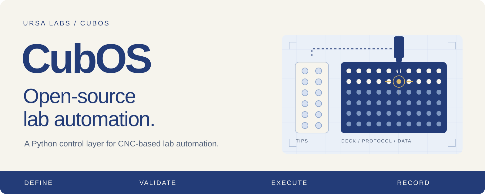
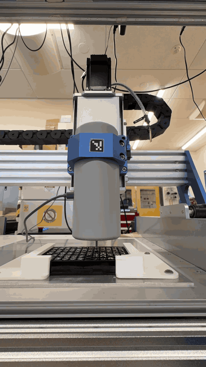
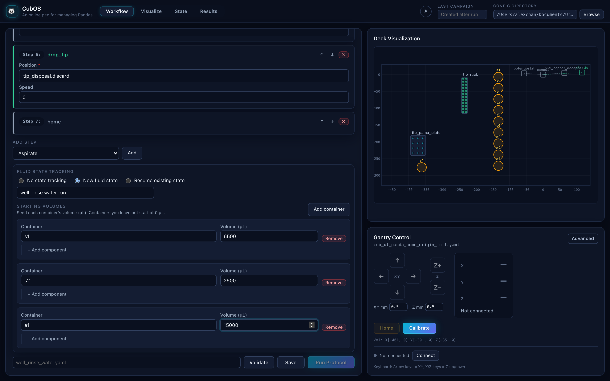

<div align="center">



### Open-source lab automation.

Gantry motion, instruments, protocols, and experiment data in one system.

[Get started](#quick-start) · [See Operator](#meet-operator) · [Write a protocol](docs/protocol-yaml.md) · [Documentation](#documentation) · [Contribute](CONTRIBUTING.md)

[](https://github.com/Ursa-Laboratories/CubOS/actions/workflows/tests.yml?query=branch%3Amain)
[](.github/workflows/tests.yml)
[](LICENSE)
[](packages/core/pyproject.toml)
[](docs/operator-ui.md)
[](docs/sila.md)

</div>

---

CubOS is an open-source Python control layer for CNC-based lab automation, built and supported by [Ursa Labs](https://ursalabs.ai). It connects GRBL gantry motion, mounted instruments, deck labware, YAML protocols, offline motion validation, and SQLite-backed experiment data into one operator and developer workflow.

## Software that reaches the bench

<p align="center">
  
</p>

<p align="center"><em>A recorded CubOS hardware demonstration over a 96-well plate.</em></p>

| Prepare | Run | Learn |
|---|---|---|
| Define the machine, labware, and steps in readable configs. | Coordinate gantry motion and instrument actions through one protocol engine. | Review saved measurements, run records, and tracked fluid state. |

Use the browser for day-to-day operation, YAML or Python to express experiments, and the API to connect other software to your station.

## Meet Operator



*Operator with PANDA liquid-handling configs and a seeded fluid state. This screenshot shows configuration and visualization; the gantry is disconnected.*

**See the setup before you run it.** Operator brings gantry setup, calibration, deck visualization, protocol editing, validation, and results into the browser. Its fluid-state tools let you define starting contents and inspect the volumes and compositions tracked by CubOS.

[Take the Operator tour →](docs/operator-ui.md)

## More than motion

| Capability | What CubOS provides |
|---|---|
| **Liquid handling** | Tip pickup, transfers, mixing, serial transfers, and compound rinse/flush workflows. |
| **Measurement & imaging** | Instrument methods at named positions, plate scans, camera capture, and lighting commands. |
| **Offline validation** | Schema, protocol semantics, and concrete motion-target checks before hardware connection. Initial-fluid seeds enable liquid-volume simulation. |
| **Experiment records** | SQLite-backed measurements, campaign data, run artifacts, and exports for analysis. |
| **Fluid state** | Optional persisted volumes, compositions, and tip usage, with reconciliation required after ambiguous interrupted operations. |
| **Extensibility** | Instrument interfaces, vendor drivers, labware definitions, and external driver-package registration. |

Tracked fluid state describes the software's record of operations; it is not an independent measurement of the liquid on the deck. See [fluid tracking](docs/fluid-state.md), [data](docs/data.md), and the [instrument guide](packages/core/src/cubos/instruments/README.md) for details and limits.

## Quick start

**Try an offline setup check first.** No gantry connection is needed. These commands use macOS/Linux shell syntax and Python 3.10+ for the core package; Operator requires Python 3.11+.

```bash
git clone https://github.com/Ursa-Laboratories/CubOS.git
cd CubOS
python3 -m venv .venv
source .venv/bin/activate
python -m pip install -e packages/core

python -m cubos.tools.validate_setup \
  packages/core/configs/gantry/cub_xl_asmi.yaml \
  packages/core/configs/deck/asmi_deck.yaml \
  packages/core/configs/protocol/asmi/move_a1.yaml
```

**Want the browser interface?** Follow [Getting Started](docs/getting-started.md) to install the API, build Operator, and launch it. That guide also covers Windows, instrument dependencies, and preinstalled stations.

**Looking for workflow configs?** Station gantry/deck files and experiment
protocols live in the [CubOS Protocol Library](https://github.com/Ursa-Laboratories/CubOS-Protocol-Library),
organized under `cub/`, `cubxl/`, and `cubxl_plus/`. The
[Polar Bear workflow](https://github.com/Ursa-Laboratories/CubOS-Protocol-Library/tree/main/cubxl_plus/polar_bear)
includes its configuration snapshots and validation status. See
[YAML File Overview](docs/configuration.md) to select an external config directory.
The files used above are bundled examples for learning and offline checks.

> [!IMPORTANT]
> CubOS controls real hardware. Before a physical run, commission and calibrate your machine, confirm that the deck matches its configuration, validate the exact setup, check physical clearance, and keep an E-stop reachable. A passing offline check does not establish physical safety or measurement accuracy.

[Bring up a machine](docs/admin/gantry-bring-up.md) · [Calibrate](docs/calibration.md) · [Run your first protocol](docs/protocol-yaml.md)

## Connect it to your workflow

Operator, the Python client, and the SiLA 2 service reach the same CubOS HTTP API. The API keeps one persistent gantry session responsible for hardware access and run execution.

```text
Operator browser ──────┐
Python SDK / CLI ──────┼── CubOS HTTP API ── Gantry session ── Hardware
SiLA 2 service ────────┘                         │
                                         Runs & results
```

- **[Python SDK & CLI](sdk/python/README.md)** — submit protocol bundles, follow runs, request cancellation, and retrieve artifacts.
- **[HTTP API](services/api/README.md)** — integrate software with the station's versioned `/api/v1` interface.
- **[SiLA 2](docs/sila.md)** — expose administrator-configured protocol presets to lab orchestrators, with progress and artifact retrieval.

## Documentation

| I want to… | Start here |
|---|---|
| Install CubOS or open an existing station | [Getting Started](docs/getting-started.md) |
| Operate a workcell from the browser | [Operator guide](docs/operator-ui.md) |
| Configure a machine and deck | [Configuration](docs/configuration.md) · [Gantry setup](docs/gantry-setup.md) · [Deck](docs/deck.md) |
| Calibrate or commission hardware | [Calibration](docs/calibration.md) · [Gantry bring-up](docs/admin/gantry-bring-up.md) |
| Write an experiment | [YAML protocols](docs/protocol-yaml.md) · [Python protocols](docs/protocol-python.md) |
| Understand recorded state and results | [Fluid tracking](docs/fluid-state.md) · [Data](docs/data.md) |
| Diagnose a problem | [Troubleshooting & recovery](docs/troubleshooting.md) |
| Extend CubOS | [Contributing](CONTRIBUTING.md) · [API reference](docs/reference/index.md) |

## Built to be opened up

CubOS is [MIT licensed](LICENSE). The runtime, Operator, API, Python client, and deployment tooling live together in this repository.

| Location | Responsibility |
|---|---|
| [`packages/core/`](packages/core/) | Gantry control, deck geometry, protocols, instruments, validation, and data |
| [`services/api/`](services/api/) | FastAPI backend and persistent hardware session |
| [`apps/operator-web/`](apps/operator-web/) | Operator browser interface |
| [`sdk/python/`](sdk/python/) | Python client and `cubos-send` command |
| [`services/sila/`](services/sila/) | SiLA 2 integration through the HTTP API |
| [`deploy/`](deploy/) | Docker, Windows, and Raspberry Pi deployment resources |

<details>
<summary><strong>For developers: install, test, and build the docs</strong></summary>

From the repository root, with a Python 3.11+ virtual environment active:

```bash
python -m pip install -e "packages/core[dev,docs]"
python -m pip install -e "services/api[dev]" -e "sdk/python[dev]"
python -m pytest packages/core/tests services/api/tests sdk/python/tests -q

npm --prefix apps/operator-web ci
npm --prefix apps/operator-web run lint
npm --prefix apps/operator-web run test -- --run
npm --prefix apps/operator-web run build

python -m mkdocs build --strict
python -m mkdocs serve
```

The test badge tracks the latest `main` workflow. The coverage badge describes the CI requirement: at least 90% of added or changed core Python lines must be covered on pull requests. It is not an overall repository coverage percentage.

Use the [contribution guide](CONTRIBUTING.md) for focused validation and hardware-facing changes. Vendor SDKs are optional extras; install only what your instruments need. Hardware validation is separate from offline software tests.

</details>

---

<div align="center">

**Open-source lab automation.**

Built and supported by [Ursa Labs](https://ursalabs.ai) · [MIT license](LICENSE) · [Get started](docs/getting-started.md)

</div>
