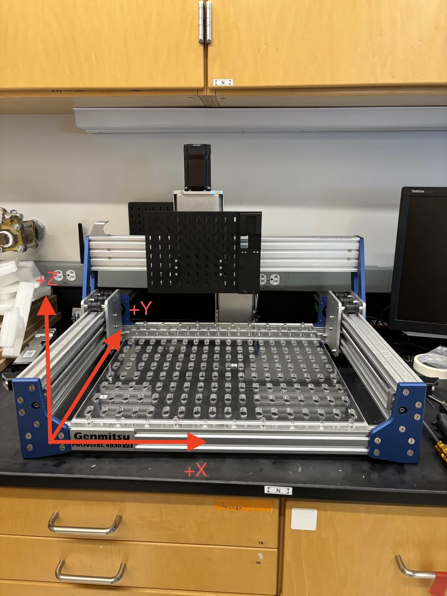

# YAML File Overview

CubOS runs from three YAML inputs: a gantry configuration, a deck layout,
and an experiment protocol. Station-specific files live in the
[CubOS Protocol Library](https://github.com/Ursa-Laboratories/CubOS-Protocol-Library).
The library follows Cubware's configuration names:

```text
CubOS-Protocol-Library/
  cub/<workflow_name>/configs/
  cubxl/<workflow_name>/configs/
  cubxl_plus/<workflow_name>/configs/
    gantry/      # machine envelope, GRBL expectations, mounted instruments
    deck/        # labware placement and calibration anchors
    protocol/    # ordered experiment steps
```

For example, [Polar Bear](https://github.com/Ursa-Laboratories/CubOS-Protocol-Library/tree/main/cubxl_plus/polar_bear)
lives under `cubxl_plus/polar_bear/`. Read the workflow README before choosing
files: an imported snapshot or uncalibrated seed is not a commissioned setup.
The repository may require access from your lab administrator.

CubOS keeps generic seeds, small documented examples, and test fixtures.
Lab-specific calibrations, experiment recipes, and historical variants belong
in the library. CubOS continues to own schemas, validation, drivers, and
execution.

## Select a workflow's configuration directory

Clone or download the library, then select the workflow's `configs/` directory
in CubOS Operator settings. For an API deployment, set `CUBOS_CONFIG_DIR` to
that directory before starting the API. For example, replace the checkout
path below with your local library path:

```sh
export CUBOS_CONFIG_DIR="/absolute/path/to/CubOS-Protocol-Library/cubxl_plus/polar_bear/configs"
```

The command-line validation and run tools also accept explicit paths to the
three YAML files; those files do not have to be inside the CubOS checkout.
Keep historical files outside the selected `configs/` directory. Validate
the chosen gantry, deck, and protocol together after calibrating and adapting
them to the physical station.

## Choose the file to edit

Use this page as a routing guide. The operator workflow pages carry the
detailed instructions.

| File | Edit it when | Primary docs |
| --- | --- | --- |
| Gantry YAML | Machine limits, GRBL expectations, or mounted instruments change. | [Calibrate Gantry](calibration.md) |
| Deck YAML | Labware, fixtures, holders, or labware positions change. | [Set Up Deck and Labware](deck.md) |
| Protocol YAML | Experimental steps, target wells, method arguments, or motion heights change. | [Run a Protocol with YAML](protocol-yaml.md) |

Use the CubOS deck frame in every file:

- origin: front-left-bottom reachable work volume
- `+X`: operator-right
- `+Y`: back, away from the operator
- `+Z`: up, away from the deck

Do not pre-flip signs in YAML. GRBL settings and calibration make the
controller coordinates match this frame.

{ width="520" }
