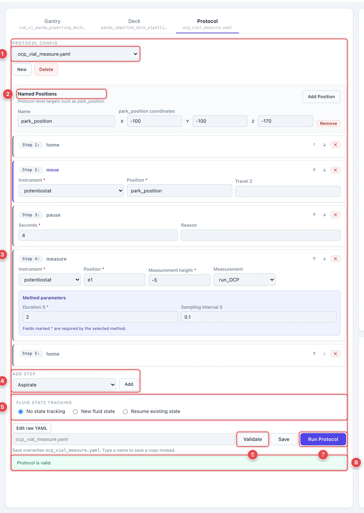
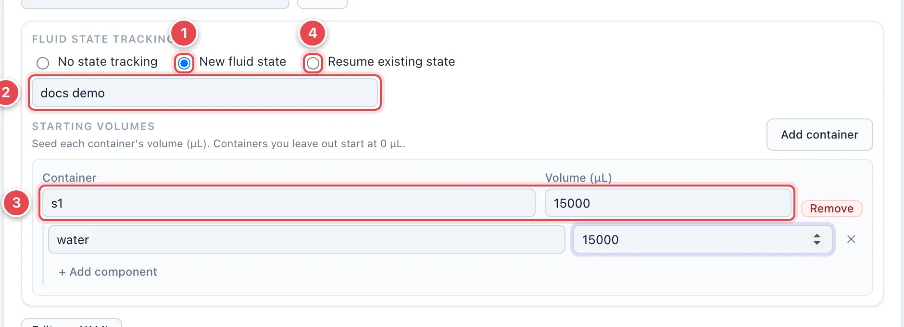
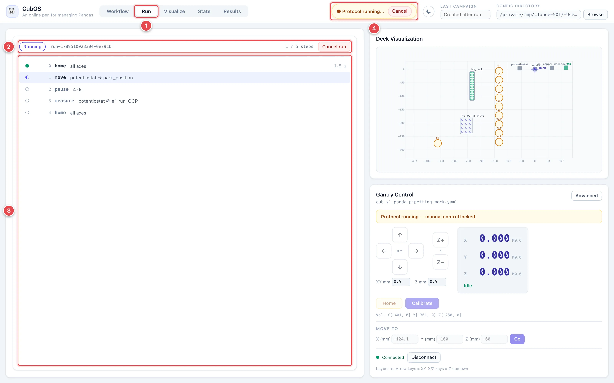
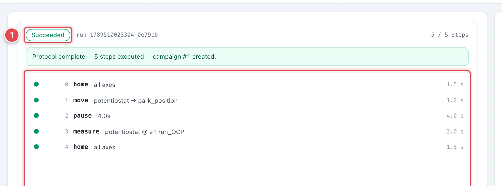

# Protocols

A protocol is a list of steps — home, move, measure, pipette, pause — that
CubOS executes against the loaded gantry and deck. This page shows how to
build one in the **Protocol** tab, validate it without moving anything, run
it, and watch it progress.

The **Protocol** tab unlocks once a saved gantry and deck are loaded.
Running also needs the gantry connected. Start with a protocol supplied
by your lab, or use **New** to build one.

## The Protocol Tab

1. **Protocol config.** Pick a protocol file, or click **New** to start an
   empty one.
2. **Named Positions.** Protocol-level XYZ targets such as a park position.
   Steps refer to them by name. **Add Position** adds a row.
3. **Step cards.** One card per step, in run order. Each shows the command
   and its parameters — here a `measure` step naming the instrument, the
   deck position (`e1`, a vial's Component ID), the measurement height
   relative to the labware surface, and the instrument method with its own
   parameters. Fields marked `*` are required by that command or method.
   The arrows on the right reorder steps; **×** removes one.
4. **Add step.** Choose a command and click **Add** to append a card.
   Positions are addressed by the Component IDs from your deck file
   (`plate.A1`) or by named positions.
   **Repeat Steps Across Wells** can then copy any consecutive block of steps
   from a template well to the checked wells. The expanded steps remain visible
   and editable before saving; image labels receive the target well suffix.

### Repeat blocks and tip use

The repeat builder expands steps in place; it does not save a hidden loop. This
makes the exact run order visible before validation.

- For a **fresh tip at every well**, include `pick_up_tip` and `drop_tip` in
  the selected From/Through range. Set the pickup position to the rack key
  alone (for example, `tip_rack_green`) so CubOS auto-selects the next unused
  tip for every copy; an explicit `tip_rack_green.A1` would target A1 again.
  The whole block is copied for each well.
- To **reuse one tip**, put `pick_up_tip` before the selected range and
  `drop_tip` after it. Only the actions between them are copied.
- Do not put `pick_up_tip` inside the block while leaving `drop_tip` outside:
  the second copy would try to pick up another tip while one is attached.
- You can create **several repeat blocks**. Expand the first one, inspect the
  resulting step numbers, then select and expand the next template block.
  Each expansion produces ordinary steps that can be edited independently.

The builder is part of the shared CubOS Protocol editor and works with any
loaded deck that exposes addressable wells; it is not tied to a particular
station.
5. **Fluid state tracking.** Whether this run records liquid volumes, tips,
   and caps. See [below](#track-liquid-state-across-runs).
6. **Validate.** Checks the saved protocol against the saved gantry and deck
   files without moving anything: every target must resolve, every move
   must stay inside the working volume once the instrument's offset and
   depth are applied, and every instrument method must exist. It cannot
   check the physical bench setup.
7. **Run Protocol.** Starts the run. Disabled while any editor has unsaved
   changes — runs use the saved files, not what is on screen.
8. **Validation result.** A green **Protocol is valid.** banner, or a red
   list of what failed and why.

**Edit raw YAML** above the save row opens the file as text, for anything
the form does not expose. See
[Run a Protocol with YAML](../protocol-yaml.md) for the full command
reference.

## Choose Steps and Heights

| Step | What it does |
|---|---|
| **Home** / **Move** | Establish the machine reference or move to a target. |
| **Measure** / **Scan** | Measure one target or every well of a plate with an instrument. |
| Pipette steps | Pick up/drop a tip, transfer liquid, mix, or perform supported liquid-handling tasks. |
| **Pause** | Wait for the configured time. |

The available commands and instrument methods appear in the form.
See [Protocol commands](../protocol-yaml.md#protocol-command-reference) for details.

**Measurement height** is measured from the labware's calibrated surface:
`0` is at the surface, `+2` is 2 mm above it, and `−2` is 2 mm below it.
**Interwell scan height** is the clearance above that surface between wells;
it must be at least the measurement height. Both must fit the machine's
travel limits. Named XYZ positions and **Travel Z** use deck coordinates
instead. Use your lab's tested heights when approaching a sample.

## Track Liquid State Across Runs

Pipetting protocols can keep a durable record of what is in every container,
which tips have been used, and which vials are capped. Pick a mode under
**Fluid state tracking** before running.

1. **New fluid state.** Start a fresh record for this run.
2. **Label.** An optional name for the new state so you can find it later.
3. **Starting volumes.** Enter the actual starting liquid in each nonempty container: its
   Component ID and volume in µL, optionally broken down by component.
   Containers you leave out start at 0 µL. CubOS checks starting amounts and blocks invalid transfers;
   verify the real liquid levels before running.
4. **Resume existing state.** Continue from a state saved by an earlier
   run, so volumes and consumed tips carry over.

**No state tracking** keeps no durable liquid or tip record. Used tips may
be selected again on the next run; replace or refresh the physical rack
before reusing a protocol in this mode. See
[Fluid State Tracking](../fluid-state.md) for how the record is stored and
resumed.

## Run and Watch

Click **Run Protocol**. The UI switches to the **Run** view, which stays
available for the rest of the session so you can come back to it.

1. **Run tab.** Return here to watch the run.
2. **Run header.** Status, run ID, step count, and **Cancel run**.
3. **Step list.** Completed, active, and pending steps. Finished steps show
   duration; failed steps show their error.
4. **Protocol running banner.** Visible in every view, with **Cancel**.
   Manual movement is locked during the run.

**Cancel run** requests a motion hold and cancellation. Wait for the final
status; an instrument action may still need to finish or report an error.
Use the machine's emergency stop if immediate intervention is needed.
A pipette holding liquid does not dispense it automatically on abort.
Check the real tip, liquid, and cap state before resuming a tracked state.

1. **Outcome.** The state pill turns green on success, and the banner under
   it reports the step count and the campaign number that was created.
2. **Completed steps.** Every step with its duration.

When the run completes, its measurements appear in the **Results** view as
a new campaign, and any tracked liquid volumes are in the **State** view.
See [Results and State](results-and-state.md).
